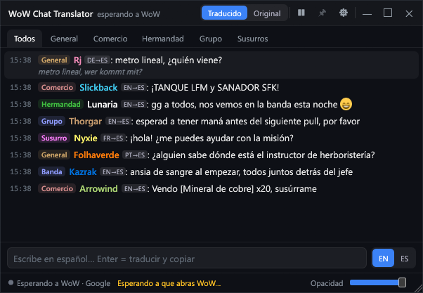
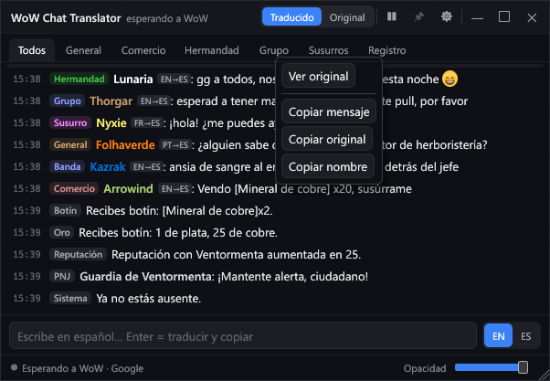
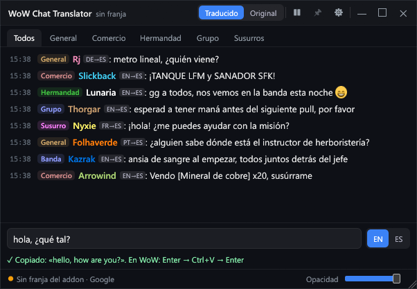

<div align="center">


# WoW Chat Translator

**Entiende el chat de World of Warcraft en español y responde en inglés sin salir del juego.**

Traducción en tiempo real · Respuestas en un atajo · Gratis y de código abierto

[**⬇ Descargar para Windows**](../../releases/latest) · [Cómo funciona](#-cómo-funciona) · [Preguntas frecuentes](#-preguntas-frecuentes)

</div>

<p align="center">
  
  <br><sub>Chat traducido con pestañas por canal, y el Registro opcional (botín, oro, sistema, PNJ) debajo.</sub>
</p>

---

## ¿Para qué sirve?

¿Juegas en un servidor en inglés y el chat de **Comercio** va demasiado rápido? ¿Te susurra
alguien en alemán y no sabes qué responder? WoW Chat Translator pone a tu lado una ventana
elegante con el chat **ya traducido al español**, con los colores de clase de cada jugador,
y te deja contestar en inglés escribiendo en español.

```
[Comercio] Slickback: TANK LFM and HEALER SFK!
       →   ¡TANQUE LFM y SANADOR SFK!

[General]  Rj: metro lineal, wer kommt mit?
       →   metro lineal, ¿quién viene?
```

## ✨ Lo que hace

- 🌍 **Traducción al instante** de cualquier idioma al español: inglés, alemán, francés, portugués…
- 🔁 **Traducido u original** para todo el chat con un clic arriba, o solo para un mensaje con **clic derecho → Ver original**. El mismo menú copia el mensaje, el original o el nombre.

  

- 🗂️ **Pestañas por canal**: Todos, General, Comercio, Hermandad, Grupo y Susurros.
- 📜 **Registro del chat (opcional)**: activa *Ajustes → General → Registro del chat* para ver también botín, oro, sistema, experiencia, reputación, logros, PNJ y emociones en la pestaña **Registro**, sin traducir. Viene desactivado.
- 🛡️ **Datos de objetos al pasar el ratón (opcional)**: en *Ajustes → General → Datos de objetos* elige *WoW (addon)* y, al pasar el ratón por un objeto enlazado, verás un panel pequeño con sus datos tal como los muestra el juego (calidad, estadísticas, requisitos). Con *Wowhead (internet)* los datos se piden a wowhead.com (necesita internet y envía el id del objeto a wowhead.com; si falla, se usan los del addon cuando los hay). Viene desactivado.
- 🎨 **Colores de clase** y nombres como en el juego. Los enlaces de objetos, misiones y logros **no se traducen**.
- 😄 **Emojis** como `:sob:` se ven como emojis de verdad.
- ✍️ **Responde en inglés**: pulsa <kbd>Ctrl</kbd>+<kbd>Shift</kbd>+<kbd>Enter</kbd>, escribe en español,
  pulsa Enter y la traducción queda copiada. En WoW: <kbd>Enter</kbd>, <kbd>Ctrl</kbd>+<kbd>V</kbd>, <kbd>Enter</kbd>.

  

- ⏸️ **Pausa** cuando quieras: en pausa, haz clic en un mensaje para traducir solo ese.
- 📌 **Siempre visible** sobre el juego, o en la bandeja del sistema cuando no juegas.
- 🧩 **Instala el addon por ti** en todas tus versiones de WoW y lo mantiene actualizado.
- 🪶 **Ligera**: app nativa de unos 70 MB de memoria, sin navegador incrustado.

## 🎮 Versiones de WoW

La app detecta sola tus instalaciones de WoW y te deja elegir en cuáles instalar el addon:

| Versión | Estado |
| --- | --- |
| WoW Forever | ✅ Probado |
| Mists of Pandaria Classic | ✅ Compatible |
| Classic Era | ✅ Compatible |
| Retail | ⚠️ Detectado, pero el addon aún no declara su versión (WoW lo marcará como "desactualizado") |

## 🚀 Instalación en 3 pasos

1. **Descarga** `WoW-Chat-Translator-Setup-0.3.0.exe` desde [Releases](../../releases/latest).
2. **Instala.** No pide administrador: se instala solo para tu usuario. La opción
   **"Iniciar con Windows"** viene marcada: la app arranca oculta y aparece sola al abrir WoW
   (puedes cambiarlo cuando quieras en *Ajustes → General* o en el icono de la bandeja).
   Al terminar deja marcado **"Abrir WoW Chat Translator"**.
3. **Acepta instalar el addon** en las versiones de WoW que quieras y entra al juego
   (o escribe `/reload` si ya estabas dentro). ¡Listo!

> [!NOTE]
> **"Windows protegió su PC"**: el instalador aún no está firmado digitalmente, así que
> SmartScreen puede avisarte. Pulsa **"Más información" → "Ejecutar de todos modos"**.

> [!TIP]
> Usa WoW en modo **"Ventana (pantalla completa)"**. Si algo no se ve, prueba ese modo primero.

## 🧠 Elige tu traductor

En *Ajustes → Traducción* eliges quién traduce:

| Traductor | Costo | Para quién |
| --- | --- | --- |
| **Google** | Gratis, sin configurar | Todo el mundo. Viene activado por defecto. |
| **OpenRouter** | Tu clave, de pago por uso (muy barato) | Quien quiere mejor calidad con la jerga del juego. |
| **LM Studio** / servidor propio | Gratis, en tu PC | Quien tiene un modelo local y buena tarjeta gráfica. |
| **Anthropic (Claude)** | Tu clave de API | Máxima calidad. |
| **Claude Code** | Tu plan de Claude | Quien ya tiene Claude Code instalado. |

Si un traductor falla, la app vuelve a Google automáticamente para que nunca te quedes sin chat.
Tus claves se guardan **cifradas** con tu usuario de Windows.

## 🔍 Cómo funciona

Un addon de WoW no puede conectarse a internet ni escribir archivos, así que usamos un truco:

1. El **addon** dibuja una tira diminuta de píxeles de colores en una esquina de la pantalla.
   Cada mensaje del chat va codificado en esos colores.
2. La **app** lee esos píxeles, como haría una captura de pantalla, y recupera el mensaje exacto.
3. La app **traduce** el mensaje y lo muestra en su ventana.

## 🛡️ Seguridad y juego limpio

- ❌ No lee la memoria del juego.
- ❌ No pulsa teclas ni mueve el ratón por ti.
- ❌ No inyecta nada en WoW.
- ✅ Solo mira píxeles de la ventana y copia tus respuestas al portapapeles: **tú** las pegas y envías.

> [!WARNING]
> Blizzard no se ha pronunciado sobre este tipo de herramientas. **Úsala bajo tu propio riesgo.**

## ❓ Preguntas frecuentes

<details>
<summary><b>¿Es gratis?</b></summary>

Sí. La app es libre (licencia MIT) y el traductor por defecto, Google, no cuesta nada.
Solo pagas si eliges un traductor con tu propia clave.
</details>

<details>
<summary><b>La ventana no aparece cuando entro al juego.</b></summary>

Comprueba que el addon esté activado en la lista de addons de WoW y escribe `/reload`.
Revisa también que WoW esté en modo "Ventana (pantalla completa)".
</details>

<details>
<summary><b>¿Puedo escribir en otros idiomas además de inglés?</b></summary>

Por ahora las respuestas se traducen de español a inglés.
</details>

<details>
<summary><b>¿Cómo la desinstalo?</b></summary>

*Configuración de Windows → Aplicaciones → WoW Chat Translator → Desinstalar*. Te pregunta si
quieres borrar tu configuración (por defecto se conserva). El addon de WoW no se borra solo:
elimina `Interface\AddOns\WoWChatTranslator` si ya no lo quieres.
</details>

## 🛠️ Compilar desde el código

Necesitas Rust (toolchain MSVC) e [Inno Setup 6](https://jrsoftware.org/isdl.php).

```powershell
cd native
cargo test
cd ..
powershell -ExecutionPolicy Bypass -File installer\build.ps1   # dist\WoW-Chat-Translator-Setup-0.3.0.exe
```

`installer\build.ps1` compila en release y ejecuta `ISCC`. Usa `-SkipCargo` para empaquetar un exe ya compilado.

## 💛 Créditos

- Hecho por **Jorge Luis Bustamante Jara**. Licencia [MIT](LICENSE).
- Emojis: Twemoji graphics by Twitter, Inc and other contributors, licensed under CC-BY 4.0.
- Idea de la tira de píxeles inspirada en [Parley](https://github.com/Duhlude/parley) y
  [LibSerpix](https://github.com/alex-berliner/LibSerpix) (ambos MIT).
- Resto de licencias: [THIRD_PARTY_NOTICES.md](THIRD_PARTY_NOTICES.md).

¿Te sirvió? Dale una ⭐ al repositorio y compártelo con tu hermandad.

---

<details>
<summary><b>English</b></summary>

**WoW Chat Translator** translates World of Warcraft chat live in a separate window and helps
you reply in English while typing in Spanish. It is a native Windows app plus a small addon.

- **Install:** run `WoW-Chat-Translator-Setup-0.3.0.exe` (per-user, no admin). If SmartScreen
  warns, click *More info → Run anyway* (the installer is unsigned). The app installs and
  updates the addon for you.
- **How it works:** the addon draws a thin pixel strip; the app reads those pixels from the game
  window, decodes the chat messages and shows the translations.
- **Translators:** Google (default, free); OpenRouter, LM Studio and Anthropic need your own key
  or server; Claude Code uses your plan's limits.
- **Safety:** no memory reading, no input automation, no injection. Replies go to the clipboard
  and you paste them yourself. Blizzard has not stated a position on this kind of tool; use it at
  your own risk.
- **License:** MIT. Third-party notices in `THIRD_PARTY_NOTICES.md`.

</details>
